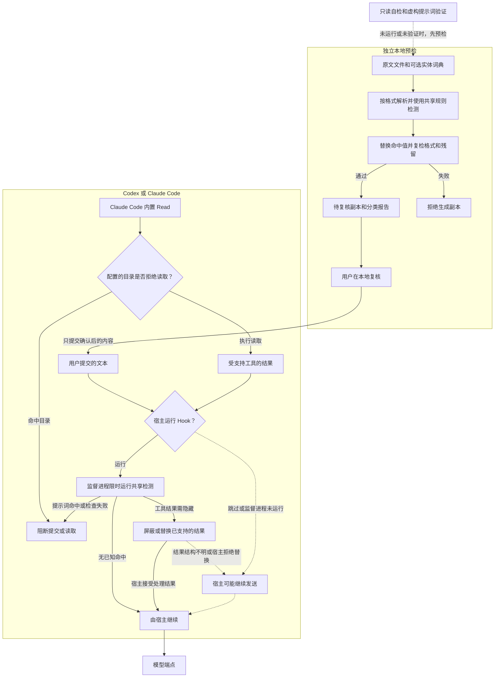

# 数据流和架构

原文有两条处理路径。敏感材料先走独立的本地预检。宿主 Hook 在会话内额外检查提示词和受支持的工具结果。

1. **独立预检。** 原文和实体词典留在本机。程序使用两端共用的规则，在支持的格式中定点替换，只在格式和残留检查通过时写出副本。报告不保存原始值和替换映射。
2. **人工复核。** 确认副本仍保留完成任务所需的事实，再由用户提交。格式校验通过仍需人工检查漏脱敏和身份线索的组合。
3. **宿主检查。** 启用并由宿主实际运行的 Hook 会调用本地扫描。Codex 拦截命中的提示词或受支持的工具结果。Claude Code 拦截命中的提示词，对已确认结果结构的工具使用原生替换。配置受保护目录时，内置 `Read` 在读取前检查路径。
4. **故障处理。** 监督进程已启动时，检查超时或异常会返回宿主可识别的失败处理。宿主跳过 Hook 时，插件无法介入原生发送按钮，应在发送前改用独立预检。Claude Code 的宿主失败阻断取决于事件和版本。
5. **验证。** 只读自检查看配置和可见记录。用虚构内容测试当前会话，才能确认 Hook 确实运行。

工具结果检查发生在工具执行后。已经发出的网络请求、附件和历史上下文有独立的数据路径。覆盖范围和验证环境见 [安全边界](privacy-boundary.md) 和 [验证记录](../VALIDATION.md)。
