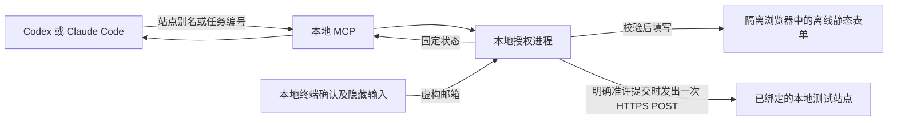

# 一次性邮箱授权实验

适用于两个本地 HTTPS 测试站点和虚构的 `.invalid` 邮箱。实验与文件脱敏和聊天 Hook 独立，需要用户主动启动并连接本地 MCP。插件包内包含运行脚本，安装插件不会启动实验或修改现有 MCP 配置。



## 安装和复现

需要 Python 3.9 或以上、OpenSSL、可执行的 Chrome 或 Chromium，以及能使用本地 MCP 的 Codex 或 Claude Code。用仓库中的测试工具可启动两个本地站点并生成临时测试证书。证书由实验进程显式信任，无须改系统证书设置。

1. 在单独的本地终端运行 `python3 tests/signup_fixtures.py`，保留该终端运行。它打印两个测试站点和测试 CA 的路径。
2. 在用于人工批准的另一个本地终端启动授权进程。将下面的占位内容换成第一步的站点、证书路径和本机浏览器可执行文件。实际授权时只允许使用虚构邮箱。

   ```sh
   python3 scripts/signup_local.py \
     --site 'site_a=<第一个测试站点的完整 HTTPS 表单地址>' \
     --ca-file '<临时测试 CA 文件>' --browser '<Chrome 或 Chromium 可执行文件>'
   ```

3. 在要测试的宿主里，按本地 STDIO MCP 的方式添加命令 `python3 /path/to/signup_mcp.py --socket /path/to/agent.sock`。脚本可来自仓库或对应插件的 `scripts` 目录，套接字路径由第二步打印。保留现有脱敏开关。[Codex MCP](https://learn.chatgpt.com/docs/extend/mcp#connect-codex-to-an-mcp-server) · [Claude Code MCP](https://code.claude.com/docs/en/mcp#option-3-add-a-local-stdio-server)
4. 请求 AI 为 `site_a` 准备测试注册，等你在本地终端批准。终端显示来源、表单路径、提交目标和邮箱字段。输入任务编号，选择 `FILL`、`SUBMIT` 或 `CANCEL`。选择批准时，在终端隐藏输入提示中填虚构邮箱。实际地址只从这个提示读入。
5. 批准后请 AI 执行同一个任务。它只收到固定状态。重复执行已消费的任务会被拒绝。结束时退出授权终端，关闭测试站点，并从宿主删除本次临时 MCP 配置。

`FILL` 只验证隔离浏览器中的离线字段填写，关闭该临时浏览器时结束，无网站提交。`SUBMIT` 在完成同样的字段验证后，额外允许一个由授权进程发送的同源 HTTPS POST。测试站点返回 204 表示它确认收到了请求，其他无法确认的结果返回 `unknown`。

也可用仓库自带的本机回环验收。测试自行生成虚构邮箱与临时配置，无需修改当前账号或人工提交。

```sh
python3 tests/signup_smoke.py \
  --codex /path/to/codex --claude /path/to/claude --browser /path/to/chromium
```

## 范围和边界

- 本地地址必须是显式端口的 `https://127.0.0.1`。授权按完整来源区分，同一 IP 的不同端口是不同站点。模型调用接口不提供批准、邮箱读取、浏览器截图或 DOM 读取。
- 首版只接收严格验证的静态单邮箱字段表单。浏览器只加载离线重建的字段，不执行站点脚本；同源提交由本地授权进程执行。第三方脚本、跨域表单、跨域跳转和修改后的表单无法用于提交。
- 授权绑定表单快照、实际接收地址和指定操作。它有短时有效期，并在执行前原子消费。同一个请求不会再次填写或提交，发生不确定结果也不会自动重试。
- 邮箱只用于本机隐藏输入、授权进程内存、私有浏览器通信和授权后的 HTTPS 请求。本地工具不把网站原始响应转给模型。试验不注册真实账号，也未实现动态站点、密码、验证码、验证码挑战或接受条款。
- 保护范围是这个 MCP 接口和专用浏览器进程。具备同一账户任意执行、调试或读取进程权限的其他程序，需要独立隔离。
